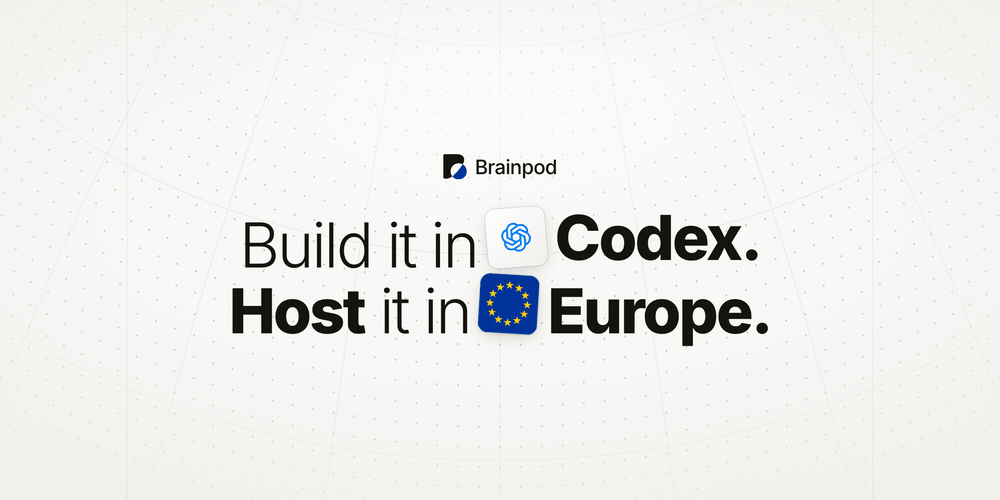

<picture>
  <source media="(prefers-color-scheme: dark)" srcset=".github/hero-dark.gif">
  
</picture>

# BrainPod Skills

[Agent Skills](https://github.com/anthropics/skills) that teach AI coding assistants (Claude Code, Cursor, Codex) how to deploy, operate, and debug applications on [BrainPod](https://brainpod.io) using the `brainpod` CLI.

## The skill

[`skills/brainpod`](./skills/brainpod) covers the whole lifecycle: getting a project onto GitHub and through BrainPod onboarding, shipping code changes as pull requests that deploy on merge, composing resources, promoting draft revisions, rolling back, and diagnosing failed builds and unhealthy deployments.

It routes to use-case references it loads on demand:

- [`references/onboard.md`](./skills/brainpod/references/onboard.md) — take a project from source to a live pod through GitHub and BrainPod onboarding.
- [`references/operate.md`](./skills/brainpod/references/operate.md) — change what an existing pod runs: code, resources, env, secrets, scale, databases, services, and rollbacks.
- [`references/debug.md`](./skills/brainpod/references/debug.md) — diagnose a build or deployment that failed, timed out, is unhealthy, or is not serving traffic.
- [`references/local-build.md`](./skills/brainpod/references/local-build.md) — build and deploy from this machine when GitHub is not an option.

## Quick start

Open your coding agent in the project you want to ship and paste:

```
Install the BrainPod skill from github.com/brainpodnl/skills and use it to deploy this project to BrainPod.

Sign me up, work out what the project needs, and hand me the live URL when it's up.
```

## Installation

Ask your agent to install it, or run one of the following yourself.

### Cursor

Install as a [Cursor plugin](https://cursor.com/docs/plugins):

```bash
/add-plugin brainpod
```

### skills CLI

Install via the [skills CLI](https://github.com/anthropics/skills):

```bash
npx skills add brainpodnl/skills --skill "brainpod"
```

### Manual symlink

Clone this repo and symlink the skill into your agent's skills directory:

```bash
git clone https://github.com/brainpodnl/skills.git /path/to/brainpod-skills
```

```bash
ln -s /path/to/brainpod-skills/skills/brainpod /path/to/skills-directory/brainpod
```

## Prerequisites

You don't need to set anything up before you start. Ask the agent to deploy something to BrainPod and it handles onboarding for you: installing the CLI if it is missing, signing you in, and walking you through connecting your GitHub repository.

For reference, what it sets up on your behalf:

**The `brainpod` CLI**, from [brainpodnl/cli](https://github.com/brainpodnl/cli). Linux and macOS on amd64 and arm64, Windows on amd64. [BrainPod Desktop](https://github.com/brainpodnl/desktop) can also install and update it, and installs this skill into your agents.

**A signed-in session.** The agent runs `brainpod login` and opens the sign-in page for you — in an embedded browser pane where its harness has one, otherwise in your default browser. You approve there and the CLI stores the token itself, so there is no token to copy and paste. Starting the flow is the agent's part; approving it is yours.

On a headless machine, in a container, or in CI, the browser flow isn't available, so create an API token in the [BrainPod console](https://console.brainpod.io) and set it instead:

```bash
export BRAINPOD_API_TOKEN=brain_...
```

The CLI also accepts `--api-token` and `brainpod config set api-token <token>`. Configuration lives at `~/.config/brainpod/config.toml`.

**Your project on GitHub.** BrainPod builds it in your repository's GitHub Actions and deploys every merge into its base branch. The agent opens pull requests for you to merge with the [`gh` CLI](https://cli.github.com); installing the BrainPod GitHub App, choosing its repositories, and merging stay with you.

**Docker with Buildx**, only for the local-build fallback, which is not recommended.

## Usage

Once installed, the agent uses the skill automatically when relevant — for example:

- Deploying a repository to BrainPod from scratch
- Fixing a failed build with a pull request
- Adding a Postgres, MariaDB, or Valkey database to an existing pod
- Changing environment variables, secrets, replica counts, or instance sizes
- Rolling back a bad deploy
- Diagnosing a deployment that reports as deployed but is not responding

## Contributing

Authoring and review guidance lives in [AGENTS.md](./AGENTS.md). It is the source of truth for how skill content in this repo is written and reviewed.
